<h1 align="center">
  Hey, I'm Rupam Rakshit 👋
</h1>

  <strong>DevOps Engineer | Cloud | Infrastructure as Code | Kubernetes | CI/CD</strong>

  
  
  

---

## 🚀 About Me

I'm a **Software Development Engineer in DevOps** focused on building reliable, scalable and automated cloud infrastructure.

🔭 Currently working at **Wipro**

☁️ Working with **AWS & Azure**

🏗️ Building infrastructure using **Terraform / Infrastructure as Code**

⚙️ Automating deployments with **CI/CD**

🐳 Working with **Docker & Kubernetes**

🔧 Exploring **DSA + AI + Cloud + DevOps Automation**

🎯 Passionate about **Cloud Infrastructure, Platform Engineering and DevSecOps**

---

## 🛠️ Tech Stack

### ☁️ Cloud

  

### 🏗️ Infrastructure & DevOps

  

### 💻 Programming & Development

  

### 📊 Monitoring

  

---
### 🐍 GitHub Contribution

  <picture>
    <source
      media="(prefers-color-scheme: dark)"
      srcset="https://raw.githubusercontent.com/Rupam200116/Rupam200116/output/github-contribution-grid-snake-dark.svg"
    />
    <source
      media="(prefers-color-scheme: light)"
      srcset="https://raw.githubusercontent.com/Rupam200116/Rupam200116/output/github-contribution-grid-snake.svg"
    />
    
  </picture>

---
### ⚙️ DevOps Ecosystem

  

---
### Certifications

---
## 📊 GitHub Stats

  
  

---
## 📈 GitHub Activity Graph

  

---

## 🌐 Connect With Me

  
  
  

---

  <i>"Building scalable solutions, one deployment at a time."</i>

  
  

